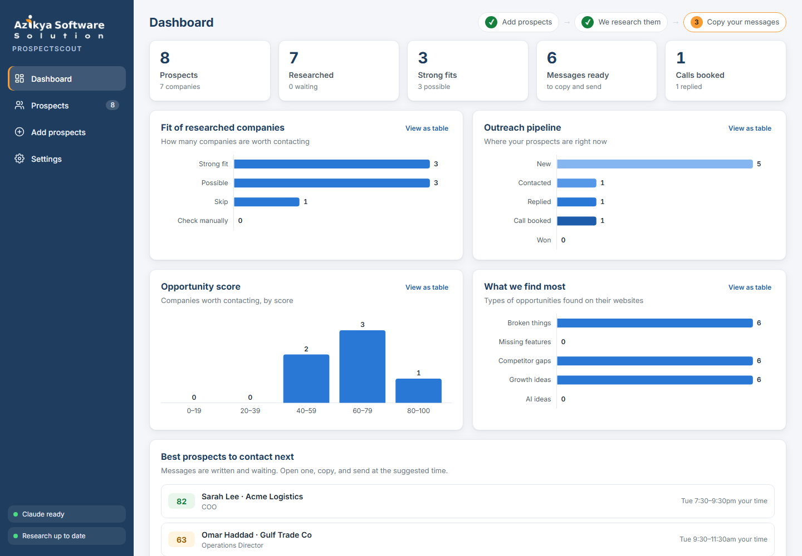
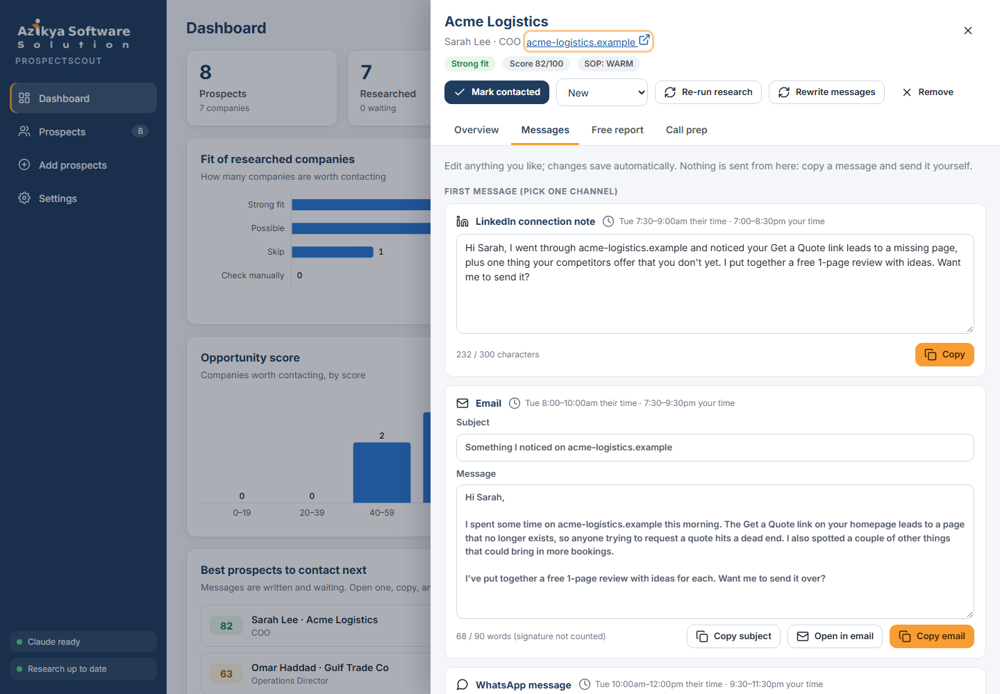
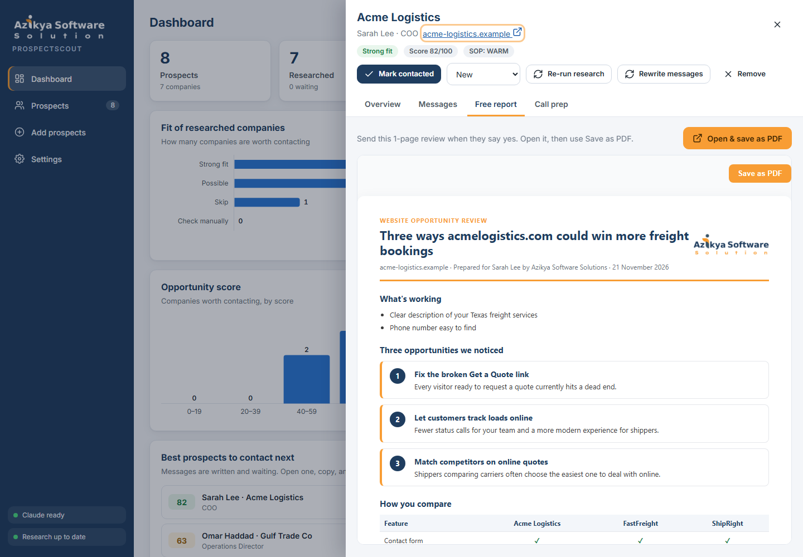

# ProspectScout

**Audit-led B2B prospecting with AI.** ProspectScout studies a prospect's website the way a senior
salesperson would before a meeting. It finds what's broken, what's missing and what competitors do
better, then writes short outreach that leads with *their* problem instead of a generic pitch.

Built by [Azikya Software Solutions](https://azikya.com) as an internal sales tool and an example of
practical, production-minded AI engineering.



## Why

Cold outreach that says "we are a software company, we do A, B and C" gets ignored. Outreach that says
*"your Get a Quote link leads to a missing page, so anyone trying to book hits a dead end"* gets
read. ProspectScout produces the second kind at scale, and every problem it mentions is backed by a check
you can see.

## What it does

1. **Takes prospects in any form:** one typed in, an Excel/CSV upload, or a public Google Sheets
   link. Columns are matched automatically (including Apollo/ZoomInfo-style exports).
2. **Audits the website with real checks** (code, not guesses): broken links and images, SSL and
   HTTPS, speed, mobile readiness, SEO basics, leftover template text, missing features (online
   booking, live chat, customer portal, pricing), tech stack, CRM/marketing tools, and hiring,
   funding and expansion signals.
3. **Analyzes with Claude.** A senior-sales playbook prompt turns verified facts into a fit
   decision, buying-intent level, opportunities (including AI/automation ideas), and a quick
   competitor comparison found by web search.
4. **Writes the outreach sequence:** LinkedIn connection note (≤300 chars), email, WhatsApp, the
   "they said yes" message, and three follow-ups. Each opener teases one real finding and offers a
   free review.
5. **Creates a free 1-page Opportunity Report** (print to PDF) to send when they reply, plus a
   private **call-prep sheet** with solutions, questions and likely objections.
6. **Suggests when to send**, per channel, in the prospect's timezone and yours.
7. **Quick Prospect**: paste one website and get a ChatGPT-style answer that streams in live. A first
   look appears within seconds, then the verdict for a Sales Navigator connection request: worth
   connecting/maybe/skip with a score, buying intent (buying now vs. partnership potential), who to
   contact, and a ready connection note. Company facts, buying signals with sources, and what to pitch
   follow below. About a minute per check; "Add to Prospects" sends it to the full research.

**Nothing is sent automatically.** Messages are copied and sent by a person, in line with
LinkedIn's and WhatsApp's rules.

| Prospect messages | Free opportunity report |
|---|---|
|  |  |

## Quality gates (why the messages can be trusted)

- Every "broken" or "missing" claim must cite a code-verified Fact id. Low-confidence facts (e.g. on
  non-English sites) can't be used in messages.
- **No prices, no timelines, no phone numbers.** Scope, timing and budget are always discussed live:
  messages say *"We can talk through scope and timing on a call or at our next meeting, and we'll
  plan it around your budget."*
- A validator rejects prices in any currency (incl. AED, Rs., USD), timelines ("2 weeks", "a couple of
  weeks"), percentages, "cheaper/discount", phone numbers, template openers, and any hint that a
  message was machine-written. It also enforces per-channel length limits and the call-to-action.
  One automatic retry; anything still off is flagged "Check messages".
- Competitor features need a source URL, and comparison rows need a verified fact on the
  prospect's side.

## Architecture at a glance

```
prospectscout/
  core/       pure business logic (importer, site model, checks, analyze, timing, sop, report, exports)
  adapters/   I/O edges (Claude Code runner, polite crawler, PageSpeed, SQLite, sheet download)
  app/        delivery (background worker queue, local HTTP server)
ui/           vanilla HTML/CSS/JS (no build step)
tests/        260+ tests, incl. a local fixture website, a fake Claude CLI and a layering guard
```

`core` never imports I/O. A test enforces it. The LLM is injected (`run=`), so swapping the
Claude Code CLI for the Anthropic API is a one-module change. Full details, diagrams and design
decisions: **[docs/ARCHITECTURE.md](docs/ARCHITECTURE.md)**.

## Run it

Requirements: Python 3.10+ and [Claude Code](https://claude.com/claude-code) installed and signed in.

```bash
pip install -r requirements.txt
python -m prospectscout          # or double-click scout.cmd on Windows
```

The app opens at `http://127.0.0.1:8902`. Fill in **Settings → You** so messages are signed by you,
then add a prospect.

- Data stays on your machine in `~/.prospectscout/` (override with `PROSPECTSCOUT_HOME`).
- To share with your team over a tunnel, first set **Settings → Access password** (or the
  `PROSPECTSCOUT_PASSWORD` environment variable). Every page then requires it.
- Exports: prospects + messages (CSV), a **ProspectIQ import file**, and a full JSON backup.

## Tests

```bash
pip install -r requirements-dev.txt
python -m pytest -q
```

CI runs the suite on Ubuntu and Windows with Python 3.10 and 3.13.
