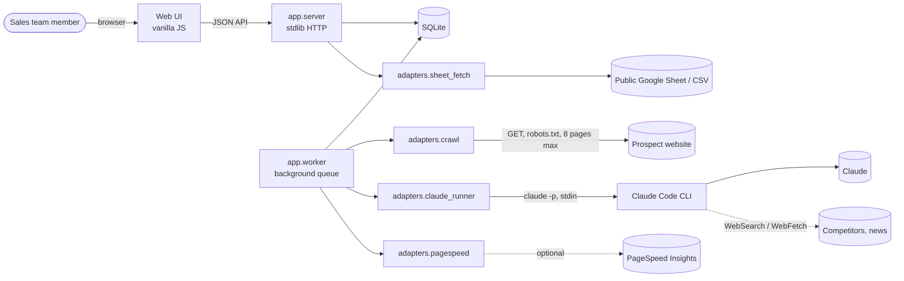
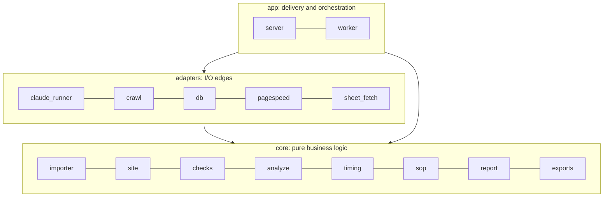
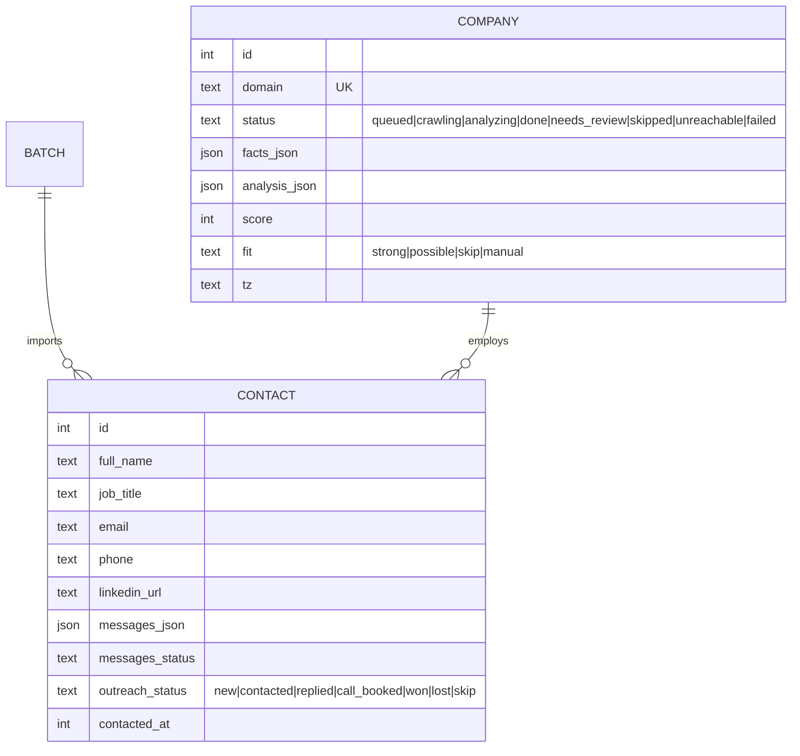

# ProspectScout architecture

## 1. System context



Everything runs on one machine. The only outbound traffic is reading prospect websites, Claude
calls, and optional PageSpeed or Sheets downloads. Nothing is ever sent to prospects.

## 2. Layers



| Layer | Rule | Enforced by |
|---|---|---|
| `core` | No network, subprocess, sqlite or socket imports; no imports from `adapters`/`app` | `tests/test_architecture.py` |
| `adapters` | May use `core` types; never imports `app` | same test |
| `app` | Wires adapters into core (e.g. `analyze_company(run=claude_runner.run_llm)`) | — |

Because the LLM is a parameter (`run`), core logic is tested with plain functions, and the
production backend can move from the Claude Code CLI (subscription) to the Anthropic API by
replacing one module with the same `run_llm(prompt, schema, tools, model, timeout)` signature.

## 3. Research pipeline (one company)

```mermaid
sequenceDiagram
    participant W as Worker
    participant C as Crawler
    participant K as Checks
    participant L as Claude (claude -p)
    participant V as Validator
    participant D as SQLite
    W->>D: claim next queued company (atomic)
    W->>C: crawl(website, 8 pages, 40 link checks)
    C-->>W: CrawlResult (pages, link statuses, SSL, redirects)
    W->>K: run_checks(result)
    K-->>W: Facts F1..Fn (kind, evidence, confidence, signal)
    W->>L: playbook + company profile + contact + Facts + page text (JSON schema)
    L-->>W: fit, findings, intent, competitors, 8 messages, report, call prep
    W->>V: validate(analysis, facts)
    alt rules broken
        W->>L: same prompt + list of broken rules (one retry)
    end
    W->>D: store analysis, score, fit, timezone; first contact's messages
    Note over W,D: other contacts at the same company become<br/>"messages only" jobs (no re-research)
```

Usage limits pause the queue and re-queue the company. A restart re-queues anything in progress.

## 4. Data model



Contact columns use ProspectIQ's `ProspectField` names, so the **ProspectIQ export** can be imported
there directly.

## 5. Trust and safety decisions

| Decision | Why |
|---|---|
| Code checks first, LLM second | An LLM reading page text can't see broken links, speed or SSL. Claims must survive the prospect checking them. |
| Every problem claim cites a Fact id | The validator rejects uncited "broken/missing" findings and low-confidence facts in messages. |
| Banned content validator + one retry | Enforces the sales rules: no prices, timelines, %, "cheaper", template openers or AI disclosure. |
| No sending from the app | LinkedIn and WhatsApp prohibit automation; people send, the tool prepares. |
| Polite crawler | Same-site only, robots.txt, delays, page/body/link caps, never submits forms, blocks private IPs (SSRF guard). |
| `--safe-mode`, never `--bare` | Keeps user plugins/hooks/CLAUDE.md out of each call while keeping subscription sign-in. |
| Optional access password | Required before exposing the app through a tunnel; HTTP Basic on every route. |
| SQLite + JSON columns | Zero setup for a local tool; schema mirrors ProspectIQ for a later move to Postgres. |

## 6. Testing

- **Unit:** importer, checks, validator, timing, SOP, report, exports (pure functions).
- **Integration:** crawler against a local fixture website (broken links, robots.txt, redirects
  across hosts, oversized pages); the HTTP API on a random port; the worker with injected fakes.
- **Contract:** a fake `claude` executable covers success, structured output, errors, usage limits
  and timeouts; a UI contract test checks every element id and API path the frontend uses.
- **Architecture:** the layering guard above.
